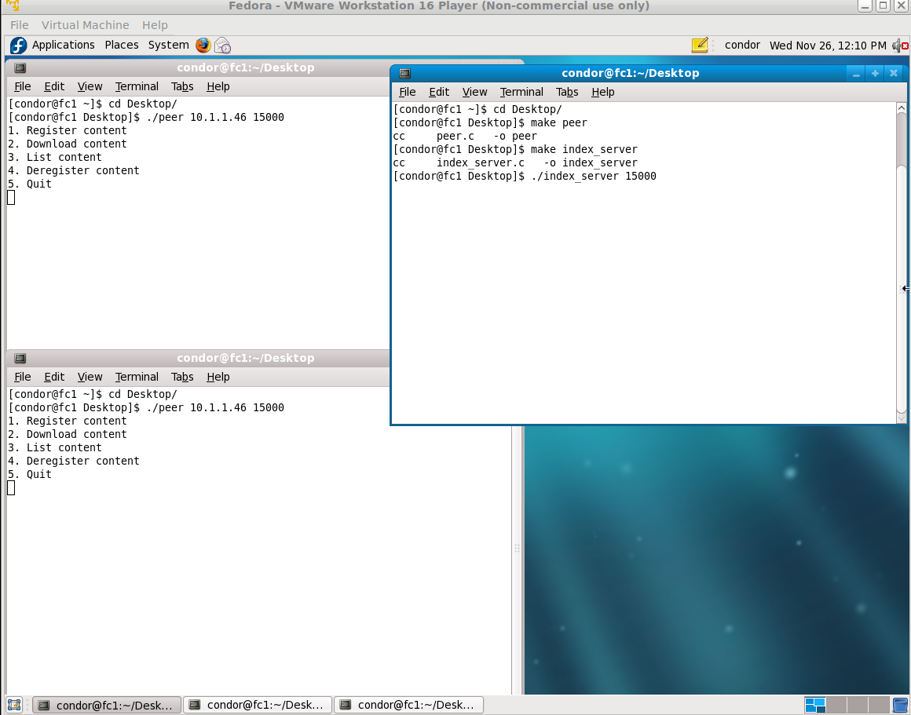
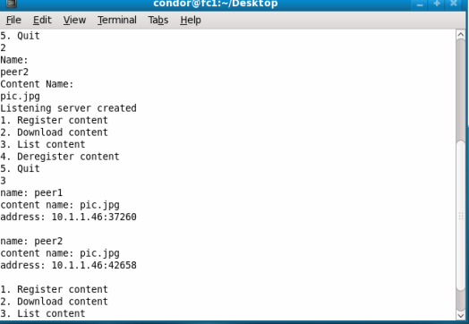
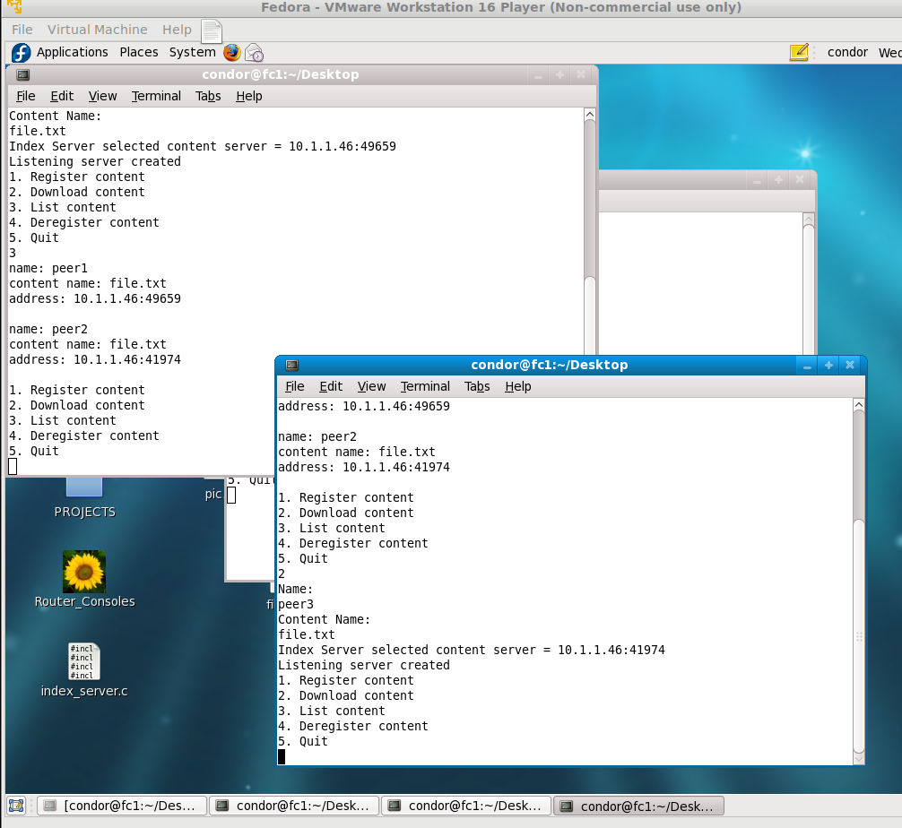

# P2P File Sharing in C

A peer-to-peer file-sharing system: a central **index server** (UDP) keeps track of who hosts which file, and peers download files **directly from each other** over TCP. Two-person course project for **COE768 Computer Networks** (Toronto Metropolitan University, Fall 2025).

**Stack:** C, POSIX sockets (UDP and TCP), `fork()` for concurrent downloads. Runs on Linux.

## How it works
Every message is a small fixed-size PDU: a one-character type plus up to 100 bytes of data.

| PDU | Direction | Meaning |
|---|---|---|
| `R` | peer → index | Register content: peer name, file name, and the TCP address the peer serves it on |
| `S` | peer → index | Search for a file; the index replies `S` with a host's address, or `E` if nobody has it |
| `D` | peer → peer (TCP) | Download request; the hosting peer streams the file back in `C` (content) PDUs |
| `O` | peer → index | List all registered content |
| `T` | peer → index | Deregister one file, or everything when a peer quits |
| `A` / `E` | index → peer | Acknowledge / error (e.g. the same peer and file are already registered) |

- **Registering a file** opens a TCP listening socket on a free port, sends an `R` PDU to the index, and `fork()`s a child process that serves downloads from that socket. The parent keeps the menu responsive.
- **Load balancing:** when several peers host the same file, the index server returns the one with the **fewest downloads so far** (a per-entry counter), spreading load across peers.
- **After a successful download,** the peer registers the file itself, so popular files spread to more hosts.
- The index stores entries in a fixed table (32 slots). Searches build a 32-bit mask of matching entries, then pick from it.

## Run it (Linux)
```bash
cc index_server.c -o index_server
cc peer.c -o peer
./index_server 15000              # terminal 1
./peer <index-server-ip> 15000    # terminals 2, 3, ...: one per peer
```
Then use the menu: 1 register, 2 download, 3 list, 4 deregister, 5 quit.

## Screenshots (Fedora VM in the lab)
| Index server and two peers | Peer 2 downloads, then hosts | Peer 3 downloads from peer 2 |
|---|---|---|
|  |  |  |

## What I'd improve
- **Fixed sizes everywhere** (10-character names, 100-byte PDUs, 32 index slots). Use length-prefixed messages and a dynamic table.
- **No authentication or integrity checks.** Any host can register or deregister content for any peer name, and files aren't hashed. Add a checksum (e.g. SHA-256) to verify downloads.
- **UDP with no retries.** A lost request just hangs. Add timeouts and resends.
- **Child processes aren't reaped** when a peer deregisters a file. Track the PIDs and stop them.
